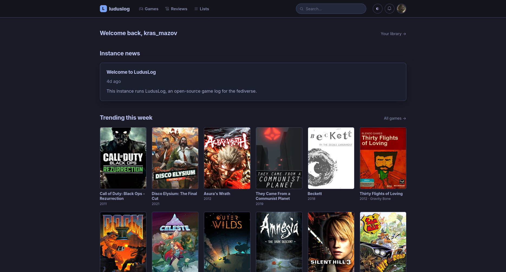

# LudusLog



LudusLog is a self-hostable, federated video game diary: log what you play, rate
games on a five-star or ten-point scale, write reviews, keep journals and
sessions, build lists, and follow other players across the fediverse.

It is a single Go binary with an embedded SQLite database, server-rendered HTML,
and progressive enhancement with htmx and hyperscript. Every page and form works
with JavaScript disabled. There is no build step, no CDN, and no external
service required to run it.

## Quick start

```sh
cp config.example.toml config.toml
# edit base_url and session_key
go run ./cmd/luduslog migrate
go run ./cmd/luduslog seed         # optional sample games
go run ./cmd/luduslog admin create you you@example.com
go run ./cmd/luduslog serve
```

Open <http://localhost:8080>. The first account created through the web UI also
becomes an administrator.

Build a binary:

```sh
CGO_ENABLED=0 go build -o luduslog ./cmd/luduslog
```

## Features

- **Games** with editions, bundles, platforms, genres, companies, relations,
  covers, release dates, and IGDB-backed metadata.
- **Logging** with statuses (played count, playing, backlog, wishlist,
  abandoned, replayed), ratings, reviews with spoilers, replay/mastered flags,
  platforms, ownership, dates, playtime, difficulty, and drafts.
- **Journals and sessions** with calendar, activity and list journal views,
  multi-day play sessions, notes, tags, and privacy.
- **Library** views for playing, backlog, wishlist, completed, and abandoned.
- **Reviews and comments** with mentions and safe Markdown.
- **Lists and folders**, ordered and ranked, public/unlisted/private.
- **Profiles** with favourites, badges, stats, yearly recaps, social links, and
  followers.
- **Notifications**, blocking, reporting, moderation roles (user/mod/admin), and an admin area with audit logging.
- **Uploaded avatars and headers** with PNG/JPEG/WebP validation, local re-encoding, and automatic resizing.
- **Editable instance settings** for safe, non-secret values; secrets stay in the config file or environment.
- **Imports and exports**: Backloggd JSON/CSV import with IGDB catalog fill, JSON/CSV export, and a backup command.
- **ActivityPub**: actors, WebFinger, NodeInfo, HTTP signatures, inbox/outbox,
  followers/following collections, notes for reviews, and game activity
  collections.

## Commands

| Command | Purpose |
| --- | --- |
| `luduslog serve` | Run migrations and start the HTTP server. |
| `luduslog migrate` | Apply embedded migrations. |
| `luduslog seed` | Insert sample games, badges, and a news post. |
| `luduslog admin create <user> <email> [password]` | Create an admin account. |
| `luduslog backup <file.db>` | Write a consistent SQLite backup. |
| `luduslog export-user <user> [out.json]` | Export a user's logs and lists. |
| `luduslog igdb sync [--limit N] [--offset N]` | Import/update games from IGDB in pages of 500. |
| `luduslog igdb fetch --id N \| --slug S \| --search "title"` | Fetch one game on demand. |
| `luduslog import backloggd <export> --user <name>` | Import a Backloggd library, fetching missing games from IGDB. |

All commands accept `-config path/to/config.toml`.

## Documentation

- [Architecture](docs/architecture.md) — packages, data flow, templates.
- [Federation](docs/federation.md) — ActivityPub surface and delivery.
- [Deployment](docs/deploy.md) — reverse proxy, backups, upgrades, TLS.
- [Contributing](docs/contributing.md) — code style and tests.
- [Decisions](docs/decisions.md) — ambiguous choices and their rationale.
- [IGDB](docs/igdb.md) — attribution, metadata, sync, and on-demand fetch.
- [Instance settings](docs/settings.md) — the editable allowlist and restart boundary.
- [Importing](docs/import.md) — Backloggd exports, status mapping, and idempotency.

## License and attribution

LudusLog is released under the [GNU Affero General Public License v3.0](LICENSE).

Game metadata can be supplied by [IGDB](https://www.igdb.com/); when enabled the
footer displays attribution. Cover images are linked from the IGDB image CDN.
LudusLog's own code and branding are original to this project.
